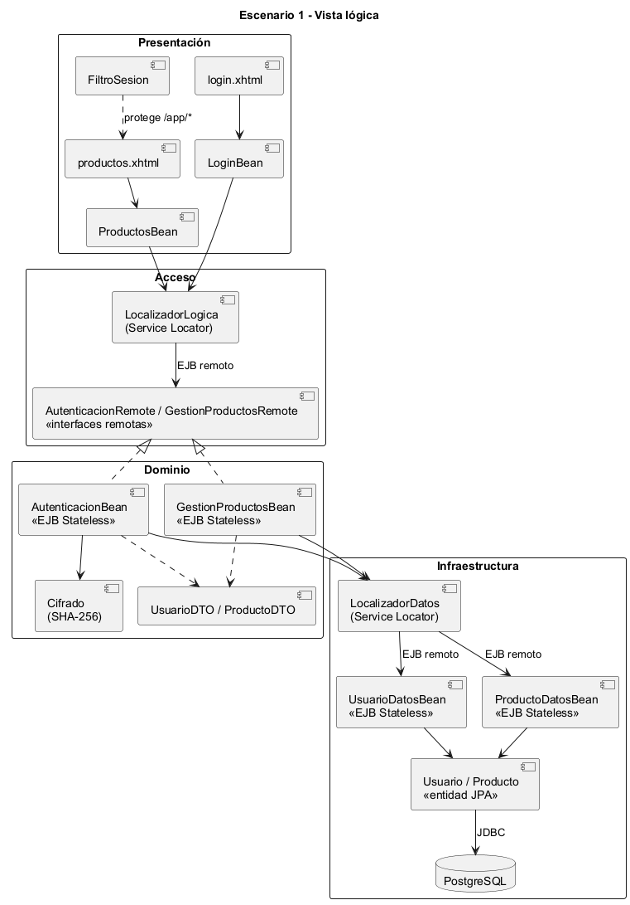
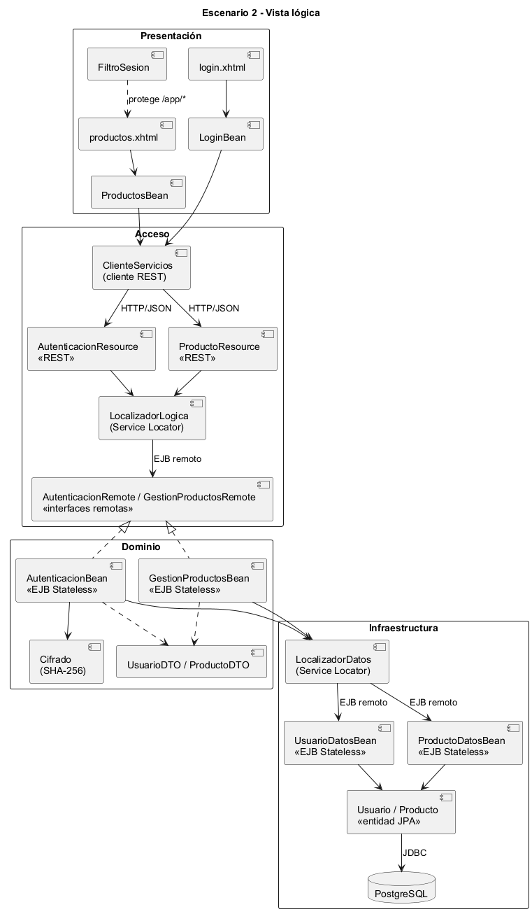
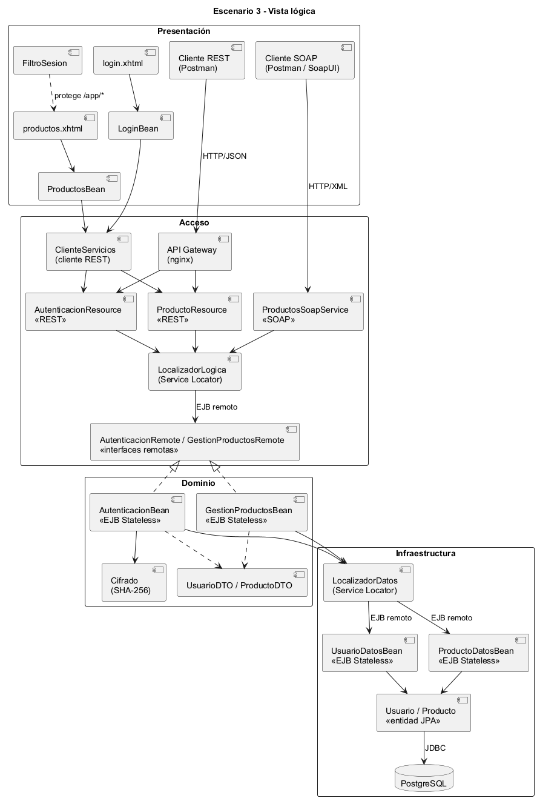
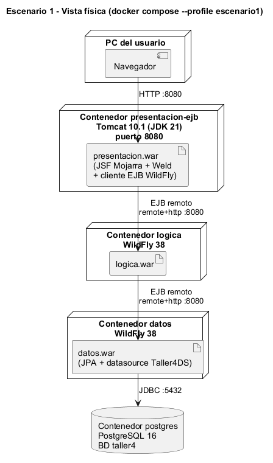
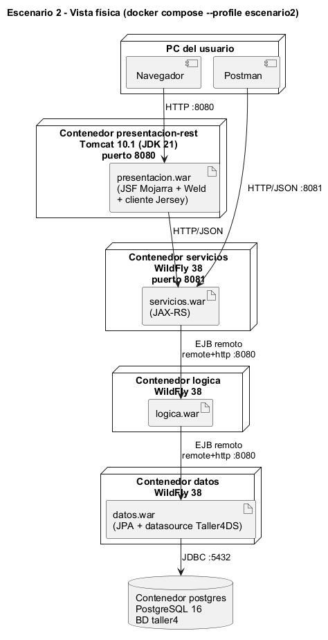
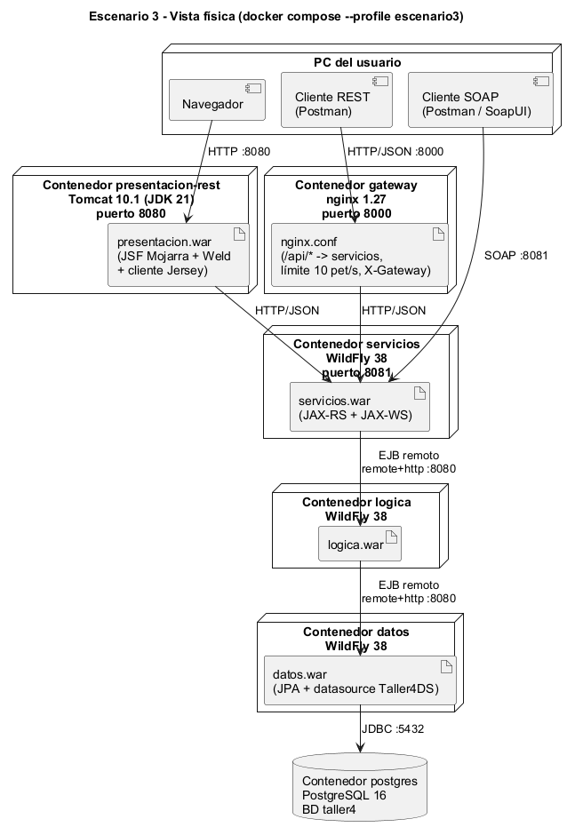
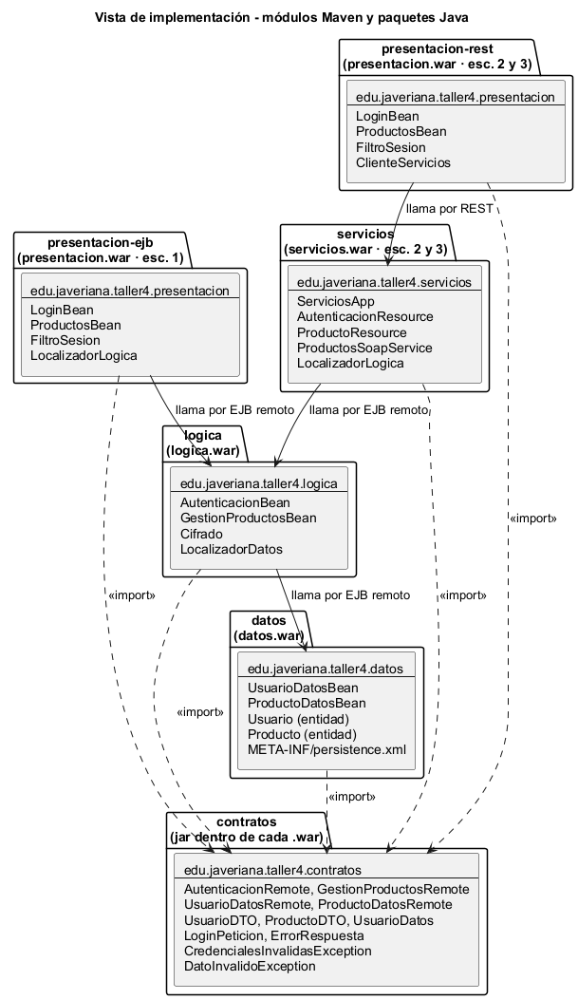

# Diseño de arquitectura: Taller No. 4 Jakarta EE, arquitecturas por capas en servidores separados

Pontificia Universidad Javeriana · Arquitectura de Software · 2026-30

## 1. Visión general

El tablero pide montar tres arquitecturas y un login sencillo:

1. **Escenario 1:** JSF (presentación) en Tomcat → Lógica en WildFly → Datos en WildFly → BD.
2. **Escenario 2:** Presentación → capa de **Servicios** → Lógica → Datos.
3. **Escenario 3:** usuarios por **REST** (pasando por un **API Gateway**) y por **SOAP**, más una
   presentación web, todos llegando a la **misma** capa de Servicios → Lógica.

El dominio es mínimo a propósito: iniciar sesión contra la base de datos y administrar una lista de
productos (listar y crear con validación). Así lo que se evalúa es la arquitectura, no el negocio.

Los tres escenarios viven en **un solo proyecto Maven** (`taller4-jee`) con un único `docker-compose.yml`.
Cada escenario es un **perfil** de Docker Compose que escoge qué servidores levantar. Los módulos
`contratos`, `datos` y `logica` son los mismos en los tres escenarios. Lo que cambia es cómo se llega a la
Lógica:

| Escenario | Quién llama a la Lógica | Cómo |
|---|---|---|
| 1 | `presentacion-ejb` (Tomcat) | EJB remoto (`remote+http`) |
| 2 | `servicios` (WildFly), llamado por `presentacion-rest` (Tomcat) | REST/JSON hasta Servicios, EJB remoto desde ahí |
| 3 | `servicios` (WildFly), llamado por la web, por clientes REST (vía nginx) y por clientes SOAP | REST/JSON y SOAP/XML hasta Servicios, EJB remoto desde ahí |

Cada capa corre en **su propio servidor** (contenedor) y solo habla con la capa de abajo. Es el patrón de
capas de Richards con **capas cerradas**: una petición no se puede saltar ninguna capa.

## 2. Vista lógica

Muestra la descomposición en las cuatro capas del curso y qué hace cada elemento:

| Capa | Responsabilidad | Elementos |
|---|---|---|
| **Presentación** | Lo que ve y usa cada tipo de usuario | `login.xhtml`, `productos.xhtml`, `LoginBean`, `ProductosBean`, `FiltroSesion`; en el escenario 3 también los clientes REST y SOAP |
| **Acceso** | Las puertas de entrada a la Lógica y la forma de encontrarla | Interfaces remotas (`AutenticacionRemote`, `GestionProductosRemote`), `LocalizadorLogica` (Service Locator), `ClienteServicios`, recursos REST, servicio SOAP y API Gateway |
| **Dominio** | Las reglas de negocio | `AutenticacionBean` (el usuario existe y el SHA-256 de la clave coincide), `GestionProductosBean` (nombre obligatorio de máximo 100 caracteres, precio mayor que cero), `Cifrado`, DTO |
| **Infraestructura** | Guardar y recuperar datos | `LocalizadorDatos`, `UsuarioDatosBean`, `ProductoDatosBean`, entidades JPA `Usuario` y `Producto`, PostgreSQL |

La regla que gobierna las tres vistas es que **las reglas de negocio solo están en Dominio**. La capa de
Acceso traduce (HTTP o SOAP ↔ llamada EJB, excepción ↔ código HTTP) y la de Infraestructura solo guarda y
consulta. Las entidades JPA no salen del servidor de Datos: se copian a DTO antes de responder.

### Escenario 1

En el escenario 1 la capa de Acceso es solo el Service Locator y las interfaces remotas: la presentación
llama directamente a los EJB de la Lógica.

### Escenario 2

En el escenario 2 la capa de Acceso crece. La presentación ya no conoce los EJB: usa `ClienteServicios`
para llamar por HTTP/JSON a los recursos REST, y son los recursos los que usan el Service Locator.
Dominio e Infraestructura no cambian.

### Escenario 3

En el escenario 3 hay tres tipos de usuario en la capa de Presentación: la web, un cliente REST y un
cliente SOAP. Los tres terminan en el mismo `LocalizadorLogica` y, por tanto, en la misma Lógica. El API
Gateway se ubica en la capa de Acceso porque es una puerta de entrada.

## 3. Vista de procesos

Cada servidor es un proceso (una JVM o nginx) en su propio contenedor. Todas las comunicaciones son
**síncronas, petición-respuesta**:

- Navegador → Tomcat: HTTP.
- Tomcat → Servicios, y gateway → Servicios: HTTP con JSON.
- Cliente SOAP → Servicios: HTTP con XML.
- Tomcat o Servicios → Lógica, y Lógica → Datos: EJB remoto por `remote+http`, con usuario `ejbuser`.
- Datos → PostgreSQL: JDBC.

No hay mensajería asíncrona. Los EJB son `@Stateless`, así que cualquier instancia atiende cualquier
llamada. La transacción la abre el servidor de Datos: los EJB de Lógica son `NOT_SUPPORTED`, para no
propagar transacciones entre servidores. Los procesos y sus conexiones se ven en la vista física.

## 4. Vista física (despliegue)

Muestra qué contenedor ejecuta cada `.war`, qué puertos quedan publicados en el PC y qué protocolo usa
cada conexión. Datos, Lógica y PostgreSQL **no publican puertos**: solo se alcanzan desde la red interna de
Docker, de modo que nadie puede saltarse las capas desde afuera.

| Contenedor | Imagen | Puerto publicado | Escenarios |
|---|---|---|---|
| postgres | `postgres:16` | no | 1, 2, 3 |
| datos | `quay.io/wildfly/wildfly:38.0.1.Final-jdk21` + driver de Postgres | no | 1, 2, 3 |
| logica | `quay.io/wildfly/wildfly:38.0.1.Final-jdk21` | no | 1, 2, 3 |
| presentacion-ejb | `tomcat:10.1-jdk21` | 8080 | 1 |
| servicios | `quay.io/wildfly/wildfly:38.0.1.Final-jdk21` | 8081 | 2, 3 |
| presentacion-rest | `tomcat:10.1-jdk21` | 8080 | 2, 3 |
| gateway | `nginx:1.27-alpine` | 8000 | 3 |

## 5. Vista de implementación

Muestra cómo se organiza el código: un módulo Maven por servidor y un jar `contratos` que todos importan.
Las flechas continuas son llamadas en ejecución entre módulos; las punteadas son `import`.

Dependencias que se respetan:

- Ningún módulo importa a otro módulo de servidor. Solo dependen de `contratos`, y en ejecución se llaman
  por EJB remoto o por REST.
- Solo `datos` conoce JPA y las entidades (`Usuario`, `Producto`).
- Solo `presentacion-ejb`, `servicios` y `logica` usan un Service Locator; `presentacion-rest` solo conoce
  la URL de la API.
- Tomcat no trae JSF, CDI ni EJB. Por eso los `.war` de presentación empaquetan Mojarra 4.0.5 y Weld 5.1.0.
  Además, `presentacion-ejb` empaqueta el cliente EJB de WildFly (`wildfly-ejb-client-bom`) y
  `presentacion-rest` empaqueta Jersey 3.1.5. Los módulos que van a WildFly usan la API de Jakarta EE 10
  como `provided`.

## 6. Escenarios (+1)

**E-1: Inicio de sesión (escenario 1).** El usuario abre `/presentacion/app/productos.xhtml` sin haber
iniciado sesión y `FiltroSesion` lo devuelve a `login.xhtml`. Escribe `admin` y `admin123`. `LoginBean`
pide a `LocalizadorLogica` el EJB `AutenticacionBean`, que vive en otro servidor, y lo llama por EJB remoto.
La Lógica revisa que los datos no vengan vacíos y le pide el usuario a la capa de Datos por EJB remoto.
Datos lo busca con JPA en PostgreSQL y devuelve una copia (`UsuarioDatos`) con el hash de la clave. La
Lógica calcula el SHA-256 de la clave escrita y lo compara. Como coinciden, devuelve un `UsuarioDTO` sin el
hash. `LoginBean` cambia el id de sesión, guarda el usuario en la sesión y redirige a la lista de
productos. Si la clave fuera incorrecta, la Lógica lanza `CredencialesInvalidasException` con el mismo
mensaje que si el usuario no existiera ("Usuario o clave incorrectos"), así no se revela cuál de los dos
falló.

**E-2: Crear un producto inválido (escenario 2).** El usuario escribe un producto con precio −5 y pulsa
Agregar. `ProductosBean` no valida nada: `ClienteServicios` envía `POST /servicios/api/productos` con el
JSON del producto. `ProductoResource` tampoco valida reglas: solo pasa nombre y precio al EJB
`GestionProductosBean` por EJB remoto. La Lógica rechaza el precio con `DatoInvalidoException` ("El precio
debe ser mayor que cero"). Servicios convierte esa excepción en un `400` con `{"mensaje": ...}` y la
presentación lo muestra en rojo. Datos nunca recibe la llamada. Si se cambiara el cliente (web, Postman o
SOAP), la regla sería la misma, porque está en un solo lugar.

**E-3: Una sola lógica, varias puertas (escenario 3).** Un cliente SOAP llama a `crearProducto` con
"Cámara web". `ProductosSoapService` le pasa la llamada a la misma Lógica que usan los recursos REST, y el
producto queda en PostgreSQL. Después, un cliente REST consulta `GET :8000/api/productos`. nginx recibe la
petición, revisa el límite por IP, la reenvía a `servicios:8080/servicios/api/productos` y le agrega el
header `X-Gateway`. La lista incluye "Cámara web". En la web JSF, que llega a Servicios por REST sin pasar
por el gateway, el producto también aparece. Lo creado desde la web se ve igualmente por SOAP. El escenario
muestra que agregar una puerta nueva (SOAP) no obligó a tocar la Lógica ni los Datos.

**E-4: La Lógica se cae (escenarios 1 a 3).** Con un usuario dentro, se apaga el contenedor de Lógica y
el usuario recarga la lista:

- En el escenario 1, el cliente EJB de Tomcat termina fallando y `ProductosBean` muestra "No se pudo
  conectar con la capa de Lógica" en el recuadro de mensajes. La primera vez tarda entre 1 y 2 minutos,
  mientras el cliente EJB da por perdida la conexión.
- En los escenarios 2 y 3, Servicios recibe una `EJBException` y `LogicaNoDisponibleMapper` la convierte en
  `503` con `{"mensaje": "La capa de Lógica no está disponible"}`. La web muestra el error en menos de 15 s
  gracias al tiempo máximo del cliente REST.

En ningún caso se cae la presentación. Es una degradación controlada: las capas que siguen vivas avisan del
problema en lugar de romperse.

## 7. Atributos de calidad y tácticas (Bass, Clements y Kazman)

| Atributo | Cómo se favorece en el taller | Táctica |
|---|---|---|
| **Modificabilidad** | Cambiar Postgres por otra BD solo toca `datos`. Agregar SOAP no tocó la Lógica. Las direcciones y usuarios de las otras capas se leen de variables de entorno | Reducir el acoplamiento: encapsular (interfaces remotas en `contratos`), usar un intermediario (Servicios, gateway), restringir dependencias (capas cerradas). Diferir el enlace: configuración en el despliegue (`docker-compose.yml`) |
| **Integrabilidad (interoperabilidad)** | La misma Lógica se ofrece por EJB remoto, REST/JSON y SOAP/XML con WSDL | Adaptar la interfaz (REST y SOAP sobre la misma operación). Descubrir el servicio (Service Locator con JNDI) |
| **Security (tríada CIA)** | La web exige login (`FiltroSesion`) y cambia el id de sesión al entrar. Las claves solo se guardan como hash. Datos y Lógica no publican puertos y exigen el usuario `ejbuser`. El gateway solo expone `/api/` | Resistir ataques: autenticar actores, limitar el acceso, limitar la exposición |
| **Disponibilidad** | Si una capa cae, las de arriba responden con un mensaje o un `503` en vez de romperse | Detectar fallas: detección de excepciones. Recuperarse: manejo de excepciones, degradación controlada |
| **Rendimiento** | El gateway limita a 10 peticiones por segundo por IP (ráfaga de 20) y protege a Servicios de un abuso | Controlar la demanda de recursos: limitar la respuesta a eventos |
| **Desplegabilidad** | Cada servidor es una imagen de Docker con su configuración. Un perfil levanta el escenario completo | Empaquetar las dependencias (imágenes con el `.war`, el driver JDBC y el datasource) |

**Compromisos asumidos:**

- **Rendimiento.** Cada capa en su propio servidor añade un salto de red por petición: hasta tres en el
  escenario 3 antes de llegar a la BD. Además, listar productos atraviesa Servicios y Lógica sin reglas
  propias, lo que Richards llama el antipatrón del "sumidero" (*architecture sinkhole*). Se acepta porque
  el objetivo del taller es mostrar la separación física de las capas.
- **Disponibilidad.** Hay más nodos y ninguno está replicado, así que cualquiera que caiga deja sin
  servicio a las capas de arriba.

## 8. Contratos

**REST** (escenario 2: `http://localhost:8081/servicios/api`; escenario 3: `http://localhost:8000/api`)

| Operación | Método y ruta | Respuestas |
|---|---|---|
| Iniciar sesión | `POST /auth/login` con `{"usuario","clave"}` | 200 con `UsuarioDTO` · 401 · 400 sin cuerpo · 503 |
| Listar productos | `GET /productos` | 200 con la lista · 503 |
| Crear producto | `POST /productos` con `{"nombre","precio"}` | 201 con el producto · 400 · 503 |

Los errores siempre llegan como `{"mensaje": "..."}` (`ErrorRespuesta`).

**SOAP** (escenario 3: `http://localhost:8081/servicios/ProductosSoap?wsdl`): `login(usuario, clave)`,
`listarProductos()` y `crearProducto(nombre, precio)`. Las excepciones de la Lógica llegan como SOAP Fault
(`CredencialesInvalidasException`, `DatoInvalidoException`).

## 9. Decisiones y supuestos

- **EJB `@Stateless` `@Remote` en Lógica y en Datos.** Es la forma de Jakarta EE de tener "objetos de
  negocio remotos", como en la clase de arquitecturas distribuidas.
- **Service Locator con JNDI** (`ejb:/<war>/<Bean>!<interfaz>`) en lugar de `@EJB`. Tomcat no tiene
  contenedor EJB y los WildFly están en máquinas distintas, así que la búsqueda remota se hace a mano en
  una sola clase por capa.
- **DTO en un jar `contratos`.** Las entidades JPA no viajan. `UsuarioDatos` (con hash) solo va de Datos a
  Lógica, y la presentación recibe `UsuarioDTO` (sin hash).
- **Excepciones de negocio checked** (`CredencialesInvalidasException`, `DatoInvalidoException`). El
  contenedor no las envuelve, así que llegan intactas al cliente remoto y Servicios puede traducirlas a
  401, 400 o a un SOAP Fault.
- **JSF en Tomcat.** El tablero pide Tomcat para la presentación. Como Tomcat es solo contenedor web, el
  `.war` lleva Mojarra y Weld.
- **nginx como API Gateway.** Es la forma más simple de tener una puerta única con enrutamiento, límite de
  peticiones y una marca visible (`X-Gateway`).
- **Un solo proyecto con perfiles.** Los tres escenarios comparten `contratos`, `datos` y `logica`; los
  perfiles evitan tener tres copias del mismo código.
- **Cómo se leyó el tablero** (foto en `tablero.webp`):
  - Las cajas de presentación de los escenarios 2 y 3 están vacías. Se usó la misma presentación JSF en
    Tomcat del escenario 1.
  - El tablero pone "wildfly" y "Payara" en Lógica y Datos. Se usó WildFly 38.
  - La flecha "→ oo∪" que sale de Lógica en el escenario 2 se leyó como "y sigue igual que en el escenario
    1". Por eso la Lógica sigue llamando a Datos y Datos a la BD. En el escenario 3 tampoco se dibujaron
    Datos ni la BD, y se dejaron por la misma razón.
  - El círculo con la X se leyó como el símbolo del API Gateway, porque tiene esa etiqueta. Solo lo cruza la
    flecha REST.
  - La flecha SOAP pasa por debajo del círculo y llega sola a Servicios, así que el cliente SOAP entra
    directo por el puerto 8081.
  - La caja de presentación del escenario 3 tiene su propia flecha a Servicios. Por eso la web no pasa por
    el gateway.
  - En el escenario 2 la capa de Servicios no dice de qué tipo es. Se implementó con REST, que es lo que
    luego usa la web en el escenario 3.
