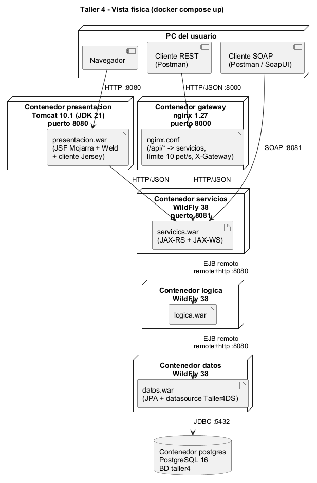
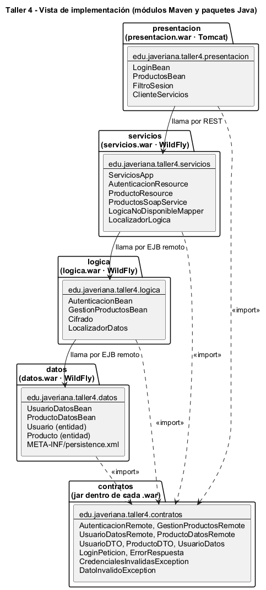

# Diseño de arquitectura: Taller No. 4 Jakarta EE, arquitectura por capas en servidores separados

Pontificia Universidad Javeriana · Arquitectura de Software · 2026-30

## 1. Visión general

El tablero (`tablero.webp`) dibuja la arquitectura en tres pasos:

1. JSF (presentación) en Tomcat → Lógica en WildFly → Datos en WildFly → BD.
2. Entre la presentación y la Lógica aparece una capa de **Servicios**.
3. A esos mismos Servicios llegan usuarios por **REST** (pasando por un **API Gateway**), usuarios por
   **SOAP** y la presentación web. Todos terminan en la misma Lógica.

Cada paso agrega algo al anterior y deja de dibujar lo que no cambia. Este proyecto implementa el **paso
3**, que es el sistema completo:

- Presentación JSF en Tomcat.
- API Gateway (nginx).
- Servicios REST y SOAP en WildFly.
- Lógica en WildFly.
- Datos en WildFly.
- PostgreSQL.

Cada uno corre en su propio contenedor. El dominio es mínimo a propósito: iniciar sesión contra la base de
datos y administrar una lista de productos (listar y crear con validación). Así lo que se evalúa es la
arquitectura, no el negocio.

Cada capa solo habla con la de abajo. Es el patrón de capas de Richards con **capas cerradas**: una
petición no se puede saltar ninguna capa.

## 2. Vista lógica

Muestra la descomposición en las cuatro capas del curso y qué hace cada elemento:

| Capa | Responsabilidad | Elementos |
|---|---|---|
| **Presentación** | Lo que ve y usa cada tipo de usuario | Web JSF (`login.xhtml`, `productos.xhtml`, `LoginBean`, `ProductosBean`, `FiltroSesion`), cliente REST y cliente SOAP |
| **Acceso** | Las puertas de entrada a la Lógica y la forma de encontrarla | API Gateway, `ClienteServicios`, recursos REST (`AutenticacionResource`, `ProductoResource`), servicio SOAP (`ProductosSoapService`), `LocalizadorLogica` (Service Locator), interfaces remotas |
| **Dominio** | Las reglas de negocio | `AutenticacionBean` (el usuario existe y el SHA-256 de la clave coincide), `GestionProductosBean` (nombre obligatorio de máximo 100 caracteres, precio mayor que cero), `Cifrado`, DTO |
| **Infraestructura** | Guardar y recuperar datos | `LocalizadorDatos`, `UsuarioDatosBean`, `ProductoDatosBean`, entidades JPA `Usuario` y `Producto`, PostgreSQL |

La regla que gobierna todas las vistas es que **las reglas de negocio solo están en Dominio**:

- La capa de Acceso solo traduce: HTTP o SOAP ↔ llamada EJB, y excepción ↔ código HTTP o SOAP Fault.
- La capa de Infraestructura solo guarda y consulta.
- Las entidades JPA no salen del servidor de Datos: se copian a DTO antes de responder.

Los tres tipos de cliente terminan en el mismo `LocalizadorLogica` y, por tanto, en la misma Lógica. El API
Gateway está en la capa de Acceso porque es una puerta de entrada.

## 3. Vista de procesos

Cada servidor es un proceso (una JVM o nginx) en su propio contenedor. Todas las comunicaciones son
**síncronas, petición-respuesta**:

| Origen → destino | Protocolo |
|---|---|
| Navegador → Tomcat | HTTP |
| Tomcat → Servicios | HTTP con JSON |
| Cliente REST → gateway → Servicios | HTTP con JSON |
| Cliente SOAP → Servicios | HTTP con XML (SOAP) |
| Servicios → Lógica → Datos | EJB remoto por `remote+http`, con usuario `ejbuser` |
| Datos → PostgreSQL | JDBC |

No hay mensajería asíncrona. Los EJB son `@Stateless`, así que cualquier instancia atiende cualquier
llamada. La transacción la abre el servidor de Datos: los EJB de Lógica son `NOT_SUPPORTED`, para no
propagar transacciones entre servidores. Los procesos y sus conexiones se ven en la vista física.

## 4. Vista física (despliegue)

Muestra qué contenedor ejecuta cada `.war`, qué puertos quedan publicados en el PC y qué protocolo usa cada
conexión. Datos, Lógica y PostgreSQL **no publican puertos**: solo se alcanzan desde la red interna de
Docker, de modo que nadie puede saltarse las capas desde afuera.

| Contenedor | Imagen | Puerto publicado |
|---|---|---|
| postgres | `postgres:16` | no |
| datos | `quay.io/wildfly/wildfly:38.0.1.Final-jdk21` + driver de Postgres | no |
| logica | `quay.io/wildfly/wildfly:38.0.1.Final-jdk21` | no |
| servicios | `quay.io/wildfly/wildfly:38.0.1.Final-jdk21` | 8081 (clientes SOAP) |
| gateway | `nginx:1.27-alpine` | 8000 (clientes REST) |
| presentacion | `tomcat:10.1-jdk21` | 8080 (navegador) |

## 5. Vista de implementación

Muestra cómo se organiza el código: un módulo Maven por servidor y un jar `contratos` que todos importan.
Las flechas continuas son llamadas en ejecución entre módulos; las punteadas son `import`.

Dependencias que se respetan:

- Ningún módulo importa a otro módulo de servidor. Solo dependen de `contratos`, y en ejecución se llaman
  por REST o por EJB remoto.
- Solo `datos` conoce JPA y las entidades (`Usuario`, `Producto`).
- `presentacion` no conoce los EJB; solo conoce la URL de la API.
- Tomcat no trae JSF ni CDI. Por eso `presentacion.war` empaqueta Mojarra 4.0.5, Weld 5.1.0 y Jersey
  3.1.5. Los módulos que van a WildFly usan la API de Jakarta EE 10 como `provided`.

## 6. Escenarios (+1)

**E-1: Inicio de sesión.**

1. El usuario abre `/presentacion/app/productos.xhtml` sin haber iniciado sesión y `FiltroSesion` lo
   devuelve a `login.xhtml`.
2. Escribe `admin` y `admin123`. `LoginBean` usa `ClienteServicios` para enviar `POST /auth/login` a
   Servicios.
3. `AutenticacionResource` no valida nada: pide a `LocalizadorLogica` el EJB `AutenticacionBean`, que vive
   en otro servidor, y lo llama por EJB remoto.
4. La Lógica revisa que los datos no vengan vacíos y le pide el usuario a la capa de Datos, también por EJB
   remoto. Datos lo busca con JPA en PostgreSQL y devuelve una copia (`UsuarioDatos`) con el hash de la
   clave.
5. La Lógica calcula el SHA-256 de la clave escrita y lo compara. Como coinciden, devuelve un `UsuarioDTO`
   sin el hash. Servicios lo envía como JSON con `200`.
6. `LoginBean` cambia el id de sesión, guarda el usuario en la sesión y redirige a la lista.

Si la clave es incorrecta, la Lógica lanza `CredencialesInvalidasException` con el mismo mensaje que si el
usuario no existiera ("Usuario o clave incorrectos"), y así no se revela cuál de los dos falló. Servicios la
convierte en `401`.

**E-2: Crear un producto inválido.** El usuario escribe un producto con precio −5 y pulsa Agregar.

1. `ProductosBean` no valida nada: `ClienteServicios` envía `POST /servicios/api/productos`.
2. `ProductoResource` tampoco valida reglas: solo pasa nombre y precio al EJB `GestionProductosBean`.
3. La Lógica rechaza el precio con `DatoInvalidoException` ("El precio debe ser mayor que cero"), y Datos
   nunca recibe la llamada.
4. Servicios convierte la excepción en un `400` con `{"mensaje": ...}`, y la web lo muestra en rojo.

Si el mismo producto llega por SOAP, la Lógica lo rechaza igual y el cliente recibe un SOAP Fault, porque la
regla está en un solo lugar.

**E-3: Una sola lógica, varias puertas.**

1. Un cliente SOAP llama a `crearProducto` con "Cámara web". `ProductosSoapService` le pasa la llamada a la
   misma Lógica que usan los recursos REST, y el producto queda en PostgreSQL.
2. Un cliente REST consulta `GET :8000/api/productos`. nginx revisa el límite por IP, reenvía la petición a
   `servicios:8080/servicios/api/productos` y agrega el header `X-Gateway`. La lista incluye "Cámara web".
3. En la web JSF el producto también aparece, y lo creado desde la web se ve igualmente por SOAP y por REST.

Agregar una puerta nueva (SOAP) no obligó a tocar la Lógica ni los Datos.

**E-4: La Lógica se cae.** Con un usuario dentro, se apaga el contenedor de Lógica y el usuario recarga la
lista.

- Servicios recibe una `EJBException` y `LogicaNoDisponibleMapper` la convierte en `503` con
  `{"mensaje": "La capa de Lógica no está disponible"}`.
- La web muestra "No se pudo conectar con la capa de Servicios" en el recuadro de mensajes en menos de 15 s,
  gracias al tiempo máximo del cliente REST.
- Un cliente REST que pase por el gateway recibe el mismo `503`.

La presentación no se cae. Es una degradación controlada: las capas que siguen vivas avisan del problema en
lugar de romperse.

## 7. Atributos de calidad y tácticas (Bass, Clements y Kazman)

| Atributo | Cómo se favorece en el taller | Táctica |
|---|---|---|
| **Modificabilidad** | Cambiar Postgres por otra BD solo toca `datos`. Agregar SOAP no tocó la Lógica. Las direcciones y usuarios de las otras capas se leen de variables de entorno | Reducir el acoplamiento: encapsular (interfaces remotas en `contratos`), usar un intermediario (Servicios, gateway), restringir dependencias (capas cerradas). Diferir el enlace: configuración en el despliegue (`docker-compose.yml`) |
| **Integrabilidad (interoperabilidad)** | La misma Lógica se ofrece por REST/JSON y por SOAP/XML con WSDL | Adaptar la interfaz (REST y SOAP sobre la misma operación). Descubrir el servicio (Service Locator con JNDI) |
| **Security (tríada CIA)** | La web exige login (`FiltroSesion`) y cambia el id de sesión al entrar. Las claves solo se guardan como hash. Datos y Lógica no publican puertos y exigen el usuario `ejbuser`. El gateway solo expone `/api/` | Resistir ataques: autenticar actores, limitar el acceso, limitar la exposición |
| **Disponibilidad** | Si una capa cae, las de arriba responden con un mensaje o un `503` en vez de romperse | Detectar fallas: detección de excepciones. Recuperarse: manejo de excepciones, degradación controlada |
| **Rendimiento** | El gateway limita a 10 peticiones por segundo por IP (ráfaga de 20) y protege a Servicios de un abuso | Controlar la demanda de recursos: limitar la respuesta a eventos |
| **Desplegabilidad** | Cada servidor es una imagen de Docker con su configuración; `docker compose up` levanta todo | Empaquetar las dependencias (imágenes con el `.war`, el driver JDBC y el datasource) |

**Compromisos asumidos:**

- **Rendimiento.** Cada capa en su propio servidor añade un salto de red por petición: hasta cuatro entre
  el cliente REST y la BD. Además, listar productos atraviesa Servicios y Lógica sin reglas propias, lo que
  Richards llama el antipatrón del "sumidero" (*architecture sinkhole*). Se acepta porque el objetivo del
  taller es mostrar la separación física de las capas.
- **Disponibilidad.** Hay más nodos y ninguno está replicado, así que cualquiera que caiga deja sin servicio
  a las capas de arriba.

## 8. Contratos

**REST** (por el gateway: `http://localhost:8000/api`)

| Operación | Método y ruta | Respuestas |
|---|---|---|
| Iniciar sesión | `POST /auth/login` con `{"usuario","clave"}` | 200 con `UsuarioDTO` · 401 · 400 sin cuerpo · 503 |
| Listar productos | `GET /productos` | 200 con la lista · 503 |
| Crear producto | `POST /productos` con `{"nombre","precio"}` | 201 con el producto · 400 · 503 |

Los errores siempre llegan como `{"mensaje": "..."}` (`ErrorRespuesta`).

**SOAP** (`http://localhost:8081/servicios/ProductosSoap?wsdl`)

- Operaciones: `login(usuario, clave)`, `listarProductos()` y `crearProducto(nombre, precio)`.
- Las excepciones de la Lógica llegan como SOAP Fault (`CredencialesInvalidasException`,
  `DatoInvalidoException`).

## 9. Decisiones y supuestos

- **EJB `@Stateless` `@Remote` en Lógica y en Datos.** Es la forma de Jakarta EE de tener "objetos de
  negocio remotos", como en la clase de arquitecturas distribuidas.
- **Service Locator con JNDI** (`ejb:/<war>/<Bean>!<interfaz>`) en lugar de `@EJB`. Los WildFly son
  servidores distintos, así que la búsqueda remota se hace a mano en una sola clase por capa.
- **DTO en un jar `contratos`.** Las entidades JPA no viajan. `UsuarioDatos` (con hash) solo va de Datos a
  Lógica, y la presentación recibe `UsuarioDTO` (sin hash).
- **Excepciones de negocio checked** (`CredencialesInvalidasException`, `DatoInvalidoException`). El
  contenedor no las envuelve, así que llegan intactas a Servicios, que las traduce a 401, 400 o SOAP Fault.
- **JSF en Tomcat.** El tablero pone la presentación en Tomcat. Como Tomcat es solo contenedor web, el
  `.war` lleva Mojarra y Weld.
- **nginx como API Gateway.** Es la forma más simple de tener una puerta única con enrutamiento, límite de
  peticiones y una marca visible (`X-Gateway`).
- **Cómo se leyó el tablero:**
  - Las cajas de presentación de los pasos 2 y 3 están vacías. Se usó JSF en Tomcat, como en el paso 1.
  - El tablero pone "wildfly" y "Payara" en Lógica y Datos. Se usó WildFly 38.
  - En el paso 3 no se dibujaron Datos ni la BD, y la flecha "→ oo∪" del paso 2 se leyó como "y sigue igual
    que en el paso 1". Por eso la Lógica sigue llamando a Datos y Datos a la BD.
  - El círculo con la X se leyó como el símbolo del API Gateway, porque tiene esa etiqueta. Solo lo cruza
    la flecha REST.
  - La flecha SOAP pasa por debajo del círculo y llega sola a Servicios, así que el cliente SOAP entra
    directo por el puerto 8081.
  - La caja de presentación tiene su propia flecha a Servicios. Por eso la web no pasa por el gateway.
